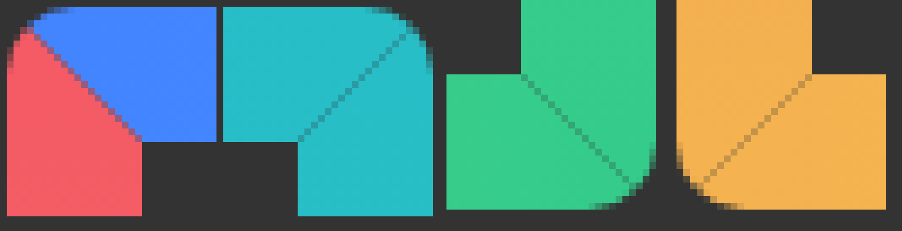

# v1.3.0 検証記録

## 四隅の修正前後

同じ1920×1080、太さ20px、グラデーション、100%のゲージについて、左上・右上・右下・左下の各32×32pxを12倍に拡大（最近傍）しました。背景の灰色は透明部分です。Beforeはv1.2.0の描画を固定したテスト用フィクスチャ、Afterは共通の新描画です。

Before：外端の1pxの余白と丸い内角。



After：外端まで埋まり、外角と内角はいずれも90度。


四隅の最外ピクセルのalphaはBefore `[0,0,0,0]` → After `[255,255,255,255]`。1920×1080／1080×1920、DPI 100／125／150／200%、太さ3／20／40px、グラデーション／単色、進行率0／25／50／75／100%の**240条件**を実Canvasで検査しています。100%では各角の太さ×太さの全ピクセルが完全不透明で、中心は透明です。

## 時間と音声

- 単体テスト85件：音声1／5／30／60秒×合成5種類×0／50／100%、フェードと停止予約、犬のループ・取消、入力範囲、点滅1／4／30／60秒の終了時刻・RESET・再通知等。
- 実際のOfflineAudioContext：合成5種類×4持続時間×3音量の**60波形**。末尾まで反復すること、指定時間後は無音になること、保守的なピーク制限を検査。
- 実Electronの非表示音声レンダラー：犬の録音を1／5／30／60秒ループし、実時間で停止・音量0へのフェードを検査。Linuxでの測定は約1.047／5.003／30.003／60.003秒。60秒の点滅も実時間で停止を確認。
- 実Electron：操作パネルを閉じても1秒の音声が再生・停止し、独立した4秒の点滅が続いた後に止まることを検査。RESET、再試聴、設定復元、音声resume拒否／永久保留でもSTARTが動くことを検査。
- Webの点滅1／4／30／60秒はブラウザ時計の早送りで検査。PiPの1秒点滅は実時間で検査し、元タブとの操作・色・サイズ同期、閉じて再表示、非対応・拒否時の通常Web版へのフォールバックも回帰検査。

**これらは再生API・波形・時計の確認です。人間が実スピーカーで6種類を聴き、音質・聞こえ方を確認したものではありません。** Windowsの物理音声デバイスの抜き差し、スリープ復帰時の聴取は未検証です。

## Windowsと配布物の検証

Windows CIではChrome／Edgeの実PiP、通常・最大化・全画面の独立したEdge上へのElectron表示、OSのポインターによるクリック・スクロール透過を検査します。Zoom／PowerPointの実アプリと物理マルチモニター／プロジェクターの実機確認とは区別します。排他的全画面、保護された画面にはOS側の制限があります。PiPは独立ウィンドウ自身の四辺を囲み、任意アプリ全体を囲む透明クリック透過枠を保証しません。

ビルド後の`app.asar`から主要10ファイルを抽出し、現在のソースとSHA-256を照合、バージョン1.3.0を確認します。`PACKAGE-MANIFEST.json`にコミットと各ハッシュを記録します。実ポータブルexeを起動して、パッケージ内の操作画面に両時間入力欄が実際に表示され、設定がメインプロセスに届くことを確認・スクリーンショット保存します。Setup版もサイレントインストール後に実アプリを起動して同じ設定欄とタイマー・描画を検査します。

CI証跡は各実行の`desktop-evidence`／`browser-evidence`。配布exeのハッシュはRelease添付の`SHA256SUMS.txt`を参照してください。Windows CIと公開後の結果はPRおよび完了報告に記載します。

```sh
npm test
npm run test:browser
npm run test:audio:web
node tests/v130-browser.mjs
npm run test:pip
npm run test:electron
npm run test:audio:electron
node tests/duration-electron.mjs
npm run desktop:win -- --publish never
node scripts/inspect-package.mjs
node tests/portable-windows.mjs # Windowsのみ
```
