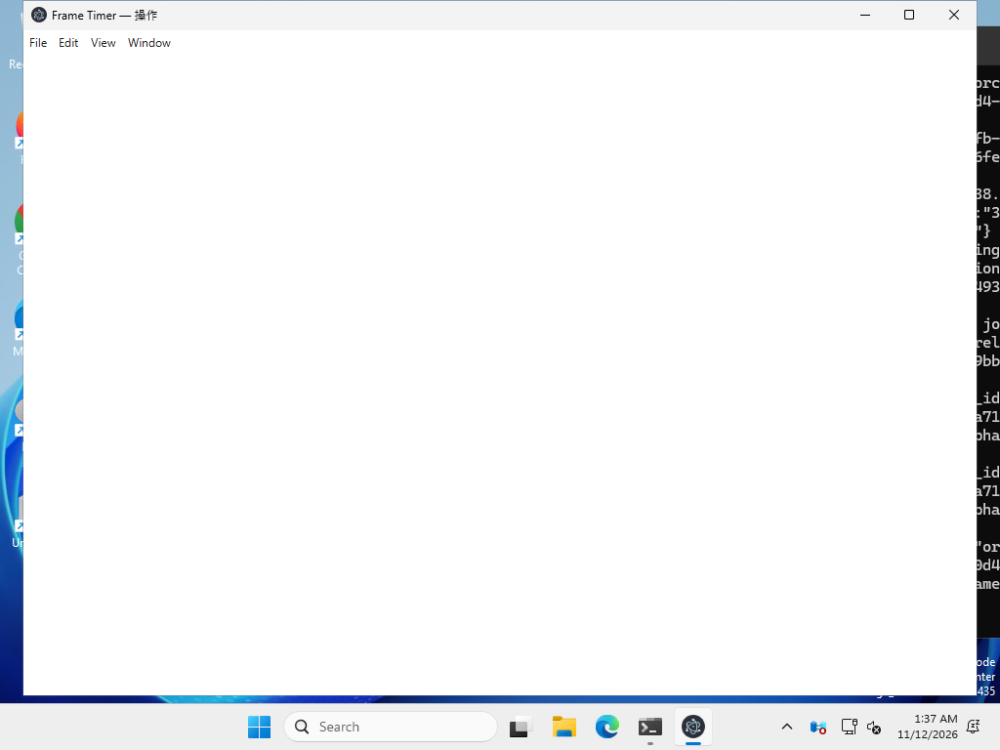

# v1.3.2 起動時の白画面：原因と検証

## 公開済みv1.3.1で再現した原因

Windows CIでGitHub Releaseのポータブルexeをそのまま起動し、TEMP/TMPのパス表記だけを小文字にすると、タイトルが「Frame Timer — 操作」の白画面を再現しました。



v1.3.1の [`electron/main.cjs:73`](https://github.com/kkodamalab/presentation-frame-timer/blob/v1.3.1/electron/main.cjs#L73) は、ローカルファイルへのアクセスを次の大文字・小文字を区別する文字列比較で制限していました。

```js
fileURLToPath(url).startsWith(root + path.sep)
```

公開exeのメインプロセスと読み込みエラーを調べた結果：

- アプリのルート：ドライブ表記 `c:`
- Chromiumが要求したファイルURL：ドライブ表記 `C:`
- 旧比較：false（拒否）
- Windowsの`path.relative`による同じ場所の判定：true
- 実際のHTMLリクエスト：`mainFrame`、`net::ERR_BLOCKED_BY_CLIENT`
- その間のウィンドウresize回数：0。レンダラーのクラッシュもなし。

HTML自体が拒否されたためCSS・JSの初期化まで進みません。さらに旧 [`main.cjs:81`](https://github.com/kkodamalab/presentation-frame-timer/blob/v1.3.1/electron/main.cjs#L81) は`ready-to-show`だけで表示し、読み込み失敗やUI初期化の監視がなく、白いウィンドウが残りました。

| 公開v1.3.1の条件 | 結果 |
| --- | --- |
| 通常TEMP、新規プロファイル | 正常 |
| v1.3.0形式の音声設定 | 正常・音量37%を復元 |
| 不正なwindow-state.json | 正常 |
| 150%相当のプロセス倍率のみ | 正常 |
| 日本語TEMPパスのみ | 正常 |
| 小文字TEMPパス | 白画面・HTML拒否 |
| 小文字＋日本語TEMP＋150%相当 | 白画面・HTML拒否 |

再現調査：[Windows実行](https://github.com/kkodamalab/presentation-frame-timer/actions/runs/43135575630)、[調査コードと画面](https://github.com/kkodamalab/presentation-frame-timer/tree/qa/v1.3.2-reproduction/evidence)。テスト用プロファイルを使用しており、利用者の設定やログを収集したものではありません。

このパス比較はv1.3.0にも存在します。利用者のPCでv1.3.0が正常・v1.3.1が異常だった環境のTEMP表記やGPUログは未取得であり、そのPCが上記と同条件だったとまでは断定しません。DPIやGPUを推測で確定原因とはしません。

## 修正

- Windowsでは`path.win32.relative`を使う、OSのパス規則に沿ったルート内判定。外部URL、別ドライブ、親ディレクトリへのアクセスは引き続き拒否。
- UI初期化・preload・HTML読み込みの3条件がそろうまで操作画面を隠す。`ready-to-show`はログのみで、起動成功の証拠にしない。
- CSSのテーママーカー、必要な入力項目、最初のIPC状態取得を確認。IPC、フォント待ち、描画フレーム待ち、全体初期化にそれぞれ期限を設ける。
- 全体初期化は8秒でタイムアウトし、1回だけ自動再試行。それでも失敗した場合は独立した診断画面へ移る。診断画面にも失敗した場合はOSのエラーダイアログを使う。
- レンダラーのクラッシュ・応答停止を監視。操作画面の再読み込みでも、メインプロセスのタイマーと音声の状態は維持。
- サイズ通知を遅延・重複排除し、同じboundsやminimum sizeを再適用しない。1ナビゲーションにつき4回までで収束させ、失敗時は安全なサイズとスクロールを維持。
- 配置だけの初期化をトレイ・診断画面から実行できる。対象はwindow-state.jsonのみで、音声・文字表示の設定を削除しない。

## 診断

保存先はユーザーデータ内の`diagnostics/startup.log`（JSON Lines）。Windowsでは通常 `%APPDATA%/presentation-frame-timer/diagnostics/startup.log` です。実際のログはトレイの「診断ログを開く」から参照できます。

HTMLのロード完了／失敗・URLとコード、preloadエラー、console error、JavaScript例外、初期化完了／失敗、レンダラー停止、GPU子プロセスの異常、起動位置・サイズ・作業領域・倍率、サイズ調整の収束を記録します。アプリ／ユーザーデータの既知ルートはログで置換し、ログは最大約1MB＋前回分にローテーションします。外部送信はしません。

## 検証

- 単体133件。起動判定、1回再試行、期限、古い初期化通知の拒否、レイアウトの収束、Windowsパスの大小文字、外部パス拒否、ログのローテーションを含む。
- 実Electronの14ケース：新規、旧設定、保存済み設定、完全終了後の再起動、不正JSON、画面外配置、ロード遅延、HTML/CSS/JS/preload失敗、初期化保留、設定を残す配置リセット、レンダラーの実クラッシュ2回。
- Windowsでは実ポータブルexeとSetupでインストールしたexeを起動。新規／既存／旧設定／不正配置、100/125/150/200%相当のプロセス倍率、小文字TEMP、日本語TEMPを検査。白画面でないことをスクリーンショットの画素比率で確認する。
- 実exeでもロード遅延・HTML/CSS/JS失敗・保留とクラッシュを注入して診断画面と再試行を検査。診断ログはテスト用プロファイル内にのみ作成する。
- v1.3.1の243表示条件と12レイアウト条件、タイマー・ゲージ・音声・点滅・クリック透過・Web/PiPも回帰検査。

最終のWindows配布物の検証結果と正常起動画面はPR・Releaseに記録します。倍率はElectronのプロセス倍率指定による検査で、物理Windows設定画面の倍率切り替えとは区別します。利用者の実PC、物理マルチモニターの抜き差し、GPUドライバー固有障害は未検証です。
